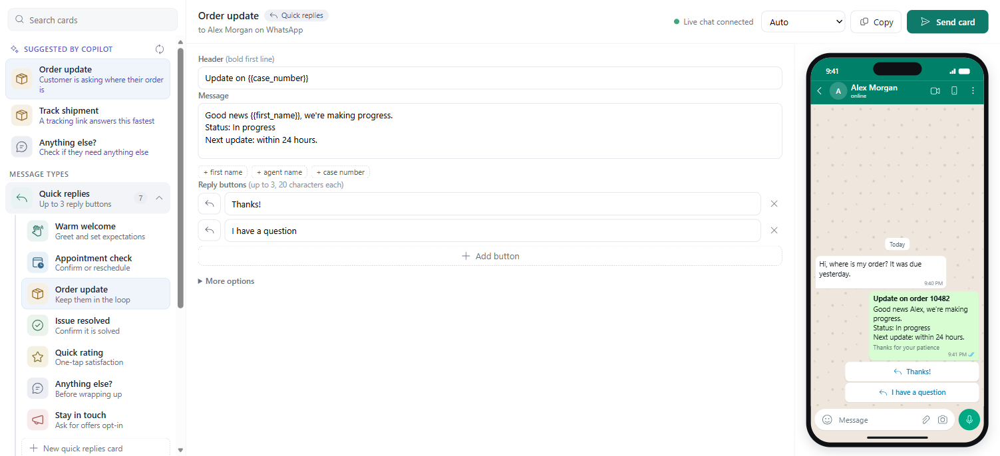
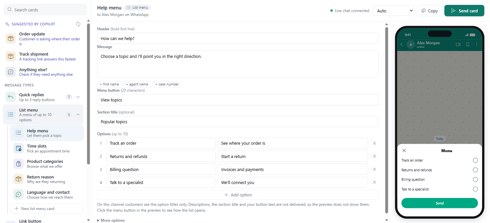
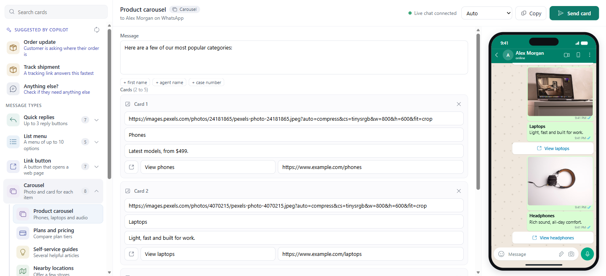

# WhatsApp Card Studio for Dynamics 365 Contact Center

**Interactive WhatsApp messages for human agents.** Pick a ready-made card, edit it, see how it looks on a phone, and send it to the customer in the live conversation.

Out of the box, a human agent in Dynamics 365 Contact Center can send text and files on the WhatsApp channel but has no way to send reply buttons, menus or link buttons from the conversation. This free, open-source add-on adds a **Card Studio** tab to the conversation form.

> Community project. Not an official Microsoft product. Tested on the first-party WhatsApp channel ("WhatsApp enabled through Meta") in Contact Center, October 2026.

> Prefer to hand it over? **[Let Scout install it for you](#option-1-let-scout-install-it-recommended)**: paste one prompt (pick the Claude Sonnet 5.5 model) and Scout does the installation and the Dynamics 365 configuration.

## What it looks like

**Pick a message type, then a card, and see how it will look on a phone.** Copilot suggests the best cards for the live conversation at the top of the list. The screenshots use a made-up customer.



**List menus:** click the menu button in the preview to open the options sheet. On this channel customers see the option titles only, so that is all the preview shows.



**Carousels become a photo and a card for each item**, one after the other, using free Pexels photos you can swap for your own. This channel has no swipeable carousel.



## What agents get

| Message type | What the customer gets | Sent as | Confirmed on a phone |
|---|---|---|---|
| **Quick replies** | Up to 3 tappable reply buttons | Native WhatsApp reply buttons | Yes |
| **List menu** | A menu of up to 10 options, **titles only** | Native WhatsApp list | The menu, yes. The final wording and button text, not yet |
| **Link button** | A button that opens a web page | Native WhatsApp link button | Yes |
| **Carousel** | A photo and a card for each item, one after the other. **Not swipeable** | A short sequence of messages | The cards, yes. The photos reaching the customer, not yet |
| **Ask for location** | A note asking for a Google or Apple Maps link or a typed address, with reply buttons. **It is not a location request**: this channel cannot send one and cannot receive location pins | Reply buttons plus text | The reply buttons, yes. The final wording, not yet |
| **Share a place** | Name, address and an Open in Maps button | Native WhatsApp link button | Yes |

See [Verification status](docs/KNOWN-GAPS.md#verification-status) for what was and was not checked.

- **34 ready-made cards** across those six types, each with a plain-English description of when to use it.
- **Message types drive the navigation.** Pick a type on the left, then one of its cards.
- **Live phone preview** that approximates how WhatsApp shows each message, limited to what this channel delivers.
- **Copilot suggestions** that read the live conversation and pick the best cards, refreshing as the chat moves on.
- **Merge fields** for the customer's first name, the agent's name and the case.
- **Your own cards:** edit any card, then save it as a new one. The internal description is never sent to customers.
- Photos for the carousel templates come from [Pexels](https://www.pexels.com) (free to use). Icons are [Fluent UI System Icons](https://github.com/microsoft/fluentui-system-icons) (MIT).

## Read this first: what the channel can and cannot do

The first-party WhatsApp channel only converts three kinds of interactive content: **reply buttons (maximum 3), link buttons and choice lists**. Everything else is dropped or shown as text. These limits come from the channel, not from this add-on, and were tested on a real phone. The full list with evidence is in **[docs/KNOWN-GAPS.md](docs/KNOWN-GAPS.md)**. The main ones:

- **No swipeable carousel** and **no images inside cards.** A carousel is sent as photo messages, each followed by a card with the title, description and link. That the photos reach the customer has not been confirmed on a phone yet.
- **No location request and no location pins.** The channel cannot send WhatsApp's "Send location" button, and a location pin shared by a customer shows up for the agent only as "Customer sent an unsupported message type", with no map or address. The Ask for location card asks for a Google or Apple Maps link or a typed address instead.
- **List menus carry option titles only.** Descriptions, the section title and the menu button text are not delivered.
- **The product's own Rich messages feature** (Copilot Service admin center) offers no cards or carousels for WhatsApp either.
- Custom cards and edited descriptions are saved in the agent's browser, not shared with the team.

## Requirements

- Dynamics 365 Contact Center (or Omnichannel for Customer Service) with a WhatsApp channel.
- **System Administrator** in the environment to install.
- [Node.js](https://nodejs.org) 18 or later and the [Azure CLI](https://learn.microsoft.com/cli/azure/install-azure-cli) (`az login`) to run the installer. You sign in yourself, including MFA.
- Optional: AI Builder / Copilot prompts for the suggestions. Without them, Card Studio falls back to keyword matching.

## Install

> **Try it in a sandbox or developer environment first.** It adds one web resource, one security role and a tab on the conversation forms.

| | Best for | Time |
|---|---|---|
| **[Option 1. Let Scout install it](#option-1-let-scout-install-it-recommended)** | You want to paste one prompt and answer a few questions. Scout does the installation **and** the Dynamics 365 configuration. | about 10 min |
| **[Option 2. One command](#option-2-one-command)** | You are comfortable with a terminal. | about 5 min |
| **[Option 3. Import it yourself](#option-3-import-the-solution-yourself)** | You prefer the Power Apps maker portal. | about 15 min |

### Option 1. Let Scout install it (recommended)

Copy the whole prompt below into **Scout** and send it. Scout downloads the release, imports the solution, adds the Card Studio tab to your conversation forms, creates the Copilot prompt, sets up access, and checks that it works with a test message. You do not have to open the maker portal, edit a form or run a command.

> **Pick the Claude Sonnet 5.5 model if you can.** In Scout, open the model picker before you paste the prompt and choose **Claude Sonnet 5.5**. It is the recommended model because it follows long, multi-step instructions most reliably. Other models may work but are less predictable. Any other assistant that can run commands and drive a browser can also use the prompt, but this project is written for Scout.

**You stay in control:** you sign in yourself, including MFA. Scout stops and asks whenever something is not as expected, and before anything that affects your live agents or customers. Scout changes only what is listed in the prompt and saves a backup of every form first.

> **Nothing to edit.** Paste the prompt exactly as it is. Scout starts by **asking you** for what it needs: your Dynamics 365 environment URL, whether it is production, which forms and which agents to include. Have those ready. You never type passwords: you sign in yourself in the browser.

````text
You are an installation engineer working inside Microsoft Scout. Install the community solution "WhatsApp Card Studio" for Dynamics 365 Contact Center in MY environment, end to end, carefully and safely: import the solution, configure the Dynamics 365 forms, create the Copilot suggestion prompt, set up access and test it. I only answer your questions and sign in. You do everything else.

SOURCE
Repository: https://github.com/moliveirapinto/d365-whatsapp-card-studio
README (source of truth): https://raw.githubusercontent.com/moliveirapinto/d365-whatsapp-card-studio/main/README.md
Known limits of the WhatsApp channel: https://raw.githubusercontent.com/moliveirapinto/d365-whatsapp-card-studio/main/docs/KNOWN-GAPS.md
Latest release (the solution zips): GET https://api.github.com/repos/moliveirapinto/d365-whatsapp-card-studio/releases/latest . Use the asset whose name ends in _managed.zip. Do NOT unzip it.
Scripts in the repository, main branch: scripts/install.mjs, scripts/add-to-forms.mjs, scripts/create-prompt.mjs.
Read the README and KNOWN-GAPS first. If they and this prompt disagree, follow the repository and tell me.

WHAT THE SOLUTION IS
One solution "WhatsApp Card Studio" (unique name WhatsAppCardStudio) with one web resource (wacs_/cards.html) and one security role ("WhatsApp Card Studio User"). A "Card Studio" tab is added to the conversation form (table msdyn_ocliveworkitem) with a web resource control that points at the web resource. A Copilot prompt called "Card Studio Suggest" (AI Builder) picks cards for the live conversation. Nothing else is created or changed.

HOW TO WORK
- Use the tools you have in Scout: the shell, the browser and web fetch. Prefer the Dataverse Web API and the repository scripts (sign in with the Azure CLI). Use the browser for steps only the portal can do.
- If you cannot run commands, or Node.js and the Azure CLI are missing and cannot be installed, switch to GUIDE MODE: give me ONE step at a time with exact click paths in the Power Apps maker portal, wait for me to say "done", and check what I report before moving on.
- Never guess. If a screen, value or count differs from this prompt, STOP and tell me exactly what you see.
- Retry a failed action at most twice, then stop and show me the exact error. A single "fetch failed" from a script is usually a slow connection, so one retry is fine.
- Only do what is listed here. Do not delete or change any other record, form, solution, flow or setting. Never touch an environment other than the one I name.
- I sign in myself, including MFA. Tell me when you need it, then wait. Do not ask me to paste passwords or tokens into this chat, and never store any.
- Anything that can affect LIVE agents or customers (changing forms in a production environment, assigning roles, sending a test message) needs my explicit "yes" first. Say what will change.
- After each phase give me one or two lines of status (OK / WARNING / FAILED) before you continue.

PHASE 0 - QUESTIONS (ask all in one message, then wait)
1. My Dynamics 365 Contact Center environment URL (for example https://contoso.crm.dynamics.com, no path). Is it a sandbox, developer or PRODUCTION environment? If production, warn me and continue only after I answer "yes, production".
2. Which conversation forms should get the Card Studio tab? Default: every main conversation form agents can open ("all"). Or tell me the form names (for example "Active Conversation").
3. Which agents should be able to use the Copilot suggestions? Give me user names or e-mails, or say "everyone who is an Omnichannel agent". Card Studio itself works for anyone who can open the conversation form.
4. Should I create the Copilot prompt "Card Studio Suggest"? It needs AI Builder prompts in this environment and uses AI Builder credits (one call per new message). If I say no, suggestions fall back to keyword matching.
5. Is there an older copy of Card Studio in this environment (a web resource such as maulabs_/cardstudio/cards.html or a tab called "Card Studio" on a form)? If you can check it yourself, do that and tell me instead of asking.
6. Do I have a WhatsApp channel in Contact Center and a phone I can use to send a test message to it? (Needed for PHASE 7.)
7. Confirm I can sign in as a System Administrator (or System Customizer plus permission to import solutions) in that environment.

PHASE 1 - PREFLIGHT (read-only)
1. Tools: run "node --version" (need 18 or later) and "az --version". If either is missing, tell me and offer to install it (Node.js from https://nodejs.org, Azure CLI from https://learn.microsoft.com/cli/azure/install-azure-cli). Install only after my "yes".
2. Get the code: "git clone https://github.com/moliveirapinto/d365-whatsapp-card-studio.git" into a working folder, or download https://github.com/moliveirapinto/d365-whatsapp-card-studio/archive/refs/heads/main.zip and extract it. Tell me the folder.
3. Sign in: "az login" (add --tenant <my tenant> if I give one). I complete the sign-in in the browser. Confirm the account is the one I named for this environment.
4. With a Dataverse token (az account get-access-token --resource <my org URL>), check and report, changing nothing:
   - The environment is reachable: GET <org>/api/data/v9.2/WhoAmI
   - It has Contact Center: GET <org>/api/data/v9.2/EntityDefinitions(LogicalName='msdyn_ocliveworkitem')?$select=LogicalName . If it is missing, STOP: Card Studio needs Dynamics 365 Contact Center or Omnichannel for Customer Service.
   - It has a WhatsApp channel: GET <org>/api/data/v9.2/msdyn_ocwhatsappchannelnumbers?$select=msdyn_name,msdyn_organizationphonenumber . If there are none, WARN me (the tab can be installed but there is nothing to test with).
   - Is the solution already installed: GET <org>/api/data/v9.2/solutions?$filter=uniquename eq 'WhatsAppCardStudio'&$select=version,ismanaged . If it is, tell me its version and ask before reinstalling.
   - The conversation forms: GET <org>/api/data/v9.2/systemforms?$filter=objecttypecode eq 'msdyn_ocliveworkitem' and type eq 2&$select=name,formid . List them for me, and say which already contain "wacs_cardstudio_tab" in their formxml.
5. BACKUP: save the formxml of every form you will change to a local folder (for example "backup-before-card-studio", one file per form named by formid) and tell me where it is. This is how to roll back.

PHASE 2 - INSTALL THE SOLUTION
1. Dry run first, changing nothing: node scripts/install.mjs --org <my org URL> --dry-run . It should say it would import the latest managed zip, or that the solution is already installed. If the release download fails, STOP and show me the error.
2. After I approve, run: node scripts/install.mjs --org <my org URL> --skip-forms --skip-prompt (the forms and the prompt get their own phases so each can be checked). Expect "Solution imported". The import can take several minutes.
3. VERIFY and report: the solution WhatsAppCardStudio exists, is managed and has the version of the release; the web resource exists: GET <org>/api/data/v9.2/webresourceset?$filter=name eq 'wacs_/cards.html'&$select=name,ismanaged ; the role exists: GET <org>/api/data/v9.2/roles?$filter=name eq 'WhatsApp Card Studio User'&$select=name (one row per business unit is normal).
4. If the zip import fails, use GUIDE MODE for this step only: Power Apps maker portal > Solutions > Import solution > Browse > the managed zip from the release > Next > Import.

PHASE 3 - CONVERSATION FORMS (the Dynamics 365 configuration)
1. If this is a production environment, remind me that every agent sees the new tab as soon as the forms are published, and ask for my "yes".
2. Run: node scripts/add-to-forms.mjs --org <my org URL> --forms "<my forms or all>" . It adds a tab named "Card Studio" (name wacs_cardstudio_tab) at the start of each chosen form, and publishes the conversation table. If an older Card Studio tab or web resource from PHASE 0 question 5 exists, tell me what you found and ask before replacing it (the script replaces a tab with the same name).
3. VERIFY: re-read each changed form and confirm its formxml contains exactly one wacs_cardstudio_tab and the control URL wacs_/cards.html. Report the forms by name.
4. Tell me to hard-refresh the agent workspace (Ctrl+Shift+R) so the forms reload.

PHASE 4 - COPILOT SUGGESTION PROMPT (only if I said yes in PHASE 0)
1. Run: node scripts/create-prompt.mjs --org <my org URL> . It creates and publishes the AI Builder prompt "Card Studio Suggest". It is safe to run twice.
2. VERIFY: GET <org>/api/data/v9.2/msdyn_aimodels?$filter=msdyn_name eq 'Card Studio Suggest'&$select=msdyn_aimodelid,statecode . statecode must be 1.
3. Smoke-test the prompt with the Predict action on that model, with inputs Customer="Alex", Conversation="Customer: Where is my order? It was due yesterday." and Cards="- id: status | Order update | Use when the customer asks where their order is." . The answer must be JSON with a suggestions list. If this fails (AI Builder not licensed or not enabled), tell me: Card Studio still works and will use keyword matching.

PHASE 5 - ACCESS
1. Agents need the security role "Omnichannel agent" (or an equivalent that lets them open conversations) to use the tab. Check the users I named in PHASE 0 and report who is missing it. Do not change their roles without my "yes".
2. For the Copilot suggestions, each agent needs read access to AI Builder prompts. Give the users I named the role "WhatsApp Card Studio User" (use the copy that belongs to each user's business unit). Show me the list first and assign only after my "yes". UI route: Power Platform admin center > Environments > my environment > Settings > Users + permissions > Users > the user > Manage security roles.
3. VERIFY: list the assignments and compare them with my list.

PHASE 6 - BROWSER CHECK
Card Studio runs inside the agent workspace and needs no extra browser settings. If the tab loads blank, check, in this order: the forms were published and refreshed, the web resource wacs_/cards.html exists, and the browser console has no blocked-content errors. Report anything you find.

PHASE 7 - END-TO-END TEST
1. Ask me to send a WhatsApp message from my phone to the channel's number and to accept the conversation in the Customer Service workspace. Do not create fake data.
2. In the conversation, open the "Card Studio" tab and check, by looking at the screen: the card list shows six message types with their cards; the status at the top right says "Live chat connected"; the phone preview shows my name; the "Suggested by Copilot" list fills in after a moment (or says it is using keyword matching).
3. Ask for my explicit "yes" to send ONE test card to my phone. Then choose the type "Quick replies", the card "Anything else?" and press "Send card". Ask me to confirm that the message arrived on my phone with two tappable buttons.
4. If something is missing, use the README and docs/KNOWN-GAPS.md. Do not change anything else without asking me.

STOP AND ASK ME WHENEVER
- a check, count or screen differs from this prompt,
- you are asked to sign in, approve MFA, accept terms or pay for anything,
- the target is production and I have not said "yes, production",
- the next action could affect live agents or customers and I have not said yes,
- you would have to do something that is not in this prompt.

FINAL REPORT
Give me a table with every phase and its result (OK, WARNING or FAILED, and what you saw). Then: (1) exactly what you changed, with the names of the solution, forms, prompt and users, (2) where the form backups are and how to roll back (node scripts/add-to-forms.mjs --org <my org URL> --remove, then delete the solution "WhatsApp Card Studio" and the prompt "Card Studio Suggest"), (3) anything I still have to do by hand, (4) a reminder of the channel limits from docs/KNOWN-GAPS.md (no swipeable carousel, no images inside cards, no native Send location button, customer location pins show as unsupported), and (5) a reminder that this is a community project, not an official Microsoft product, and that a sandbox test comes first.

START with PHASE 0.
````

#### What this prompt cannot do for you

- It cannot sign in for you or approve MFA.
- It cannot test sending without a real WhatsApp message from your own phone.
- It cannot create the Copilot prompt if AI Builder prompts are not available in your environment. Card Studio still works and uses keyword matching.
- It cannot add features the WhatsApp channel does not support. See [docs/KNOWN-GAPS.md](docs/KNOWN-GAPS.md).

### Option 2. One command

```
git clone https://github.com/moliveirapinto/d365-whatsapp-card-studio.git
cd d365-whatsapp-card-studio
az login
node scripts/install.mjs --org https://yourorg.crm.dynamics.com
```

The installer is safe to run twice. It checks the environment, imports the managed solution from the latest release, adds the **Card Studio** tab to the conversation forms and creates the "Card Studio Suggest" prompt. Use `--dry-run` to see what it would do, `--skip-forms` or `--skip-prompt` to leave those steps out.

### Option 3. Import the solution yourself

1. Download `WhatsAppCardStudio_1.0.1_managed.zip` from the [latest release](../../releases/latest).
2. In the Power Apps maker portal, open **Solutions > Import solution** and import it.
3. Add the tab to your forms: `node scripts/add-to-forms.mjs --org https://yourorg.crm.dynamics.com`, or add a new tab with a web resource control pointing at `wacs_/cards.html` on the conversation form.
4. Optional: create the suggestion prompt with `node scripts/create-prompt.mjs --org https://yourorg.crm.dynamics.com`.

An unmanaged zip is also attached to each release if you want to edit the page in your environment.

### Agents who can't see suggestions

Give them the **WhatsApp Card Studio User** role. It only grants read access to AI Builder prompts.

## Use it

1. Accept a WhatsApp conversation in the Customer Service workspace.
2. Open the **Card Studio** tab on the conversation.
3. Pick a message type, then a card. Copilot's suggestions for the current chat appear at the top.
4. Edit the text, buttons or photos. The phone preview updates as you type.
5. Press **Send card**. A status line shows whether the live chat is connected.

The delivery menu next to the button has **Auto** (recommended), **Interactive card** and **Plain text**. If there is no live chat, Card Studio offers to copy the message instead.

## How it works

Card Studio is one HTML web resource on the conversation form. It finds the chat widget in the Communication Panel and sends messages through the same pipeline the agent's own typing uses, shaped as adaptive cards that the channel converts to WhatsApp buttons and lists. Photos are attached through the panel's file attach, re-encoded as standard JPEG first. Suggestions call an AI Builder prompt through the Dataverse API with the recent conversation and each card's internal description.

Because it relies on the chat widget's page, a product update that changes the widget could affect sending. When that happens, Card Studio falls back to formatted text or copy.

## Remove it

```
node scripts/add-to-forms.mjs --org https://yourorg.crm.dynamics.com --remove
```

Then delete the **WhatsApp Card Studio** solution and the **Card Studio Suggest** prompt.

## Build from source

```
node build/build.mjs
```

Builds the managed and unmanaged zips into `dist/`. No dependencies. Source is in `src/cards.html` (the page) and `src/icons.json` (inlined Fluent icons).

## License

MIT. See [LICENSE](LICENSE). Fluent UI System Icons are MIT licensed by Microsoft. Pexels photos are used under the [Pexels license](https://www.pexels.com/license/).
